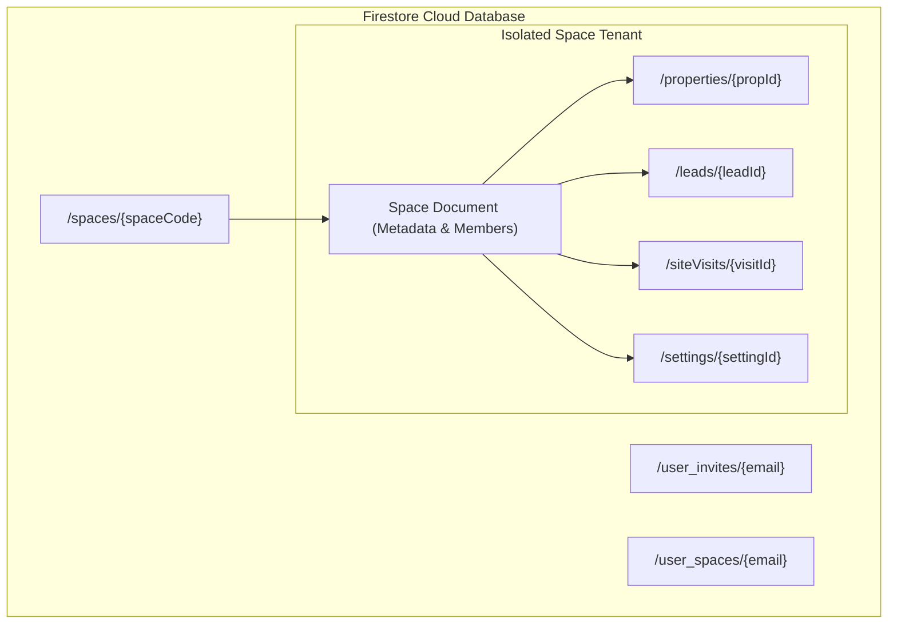
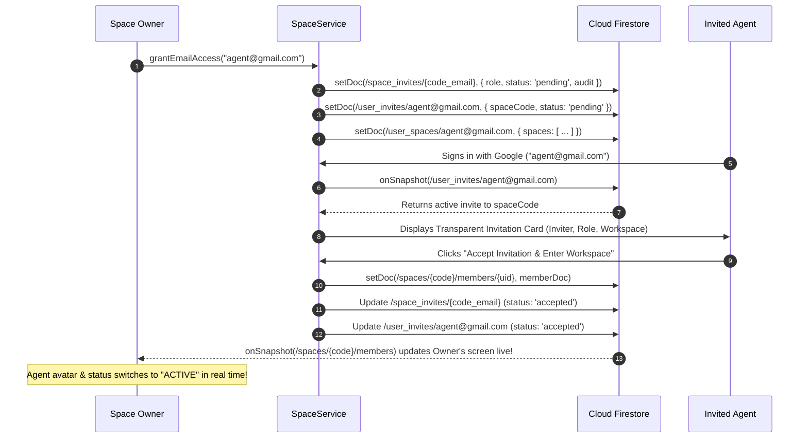
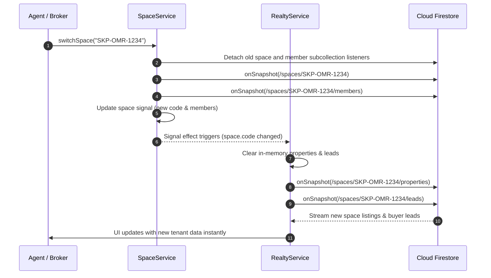

# SkyPearl Spaces — Backend & Firestore Architecture Guide

This document explains the **Backend Data Model, Firestore Architecture, Security Rules, and Real-Time Synchronization** powering the multi-tenant Spaces system in SkyPearl Realty.

---

## 1. High-Level Backend Architecture

SkyPearl Realty utilizes a **Serverless Cloud Architecture** powered by **Google Firebase Cloud Firestore** and **Firebase Authentication**.

Each agency workspace or branch is an isolated tenant identified by a unique **Space Code** (e.g. `SKP-CHN-4829`). All inventory, CRM buyer leads, and client site visits are compartmentalized under that space's subcollections.



---

## 2. Firestore Collections & Schema Definitions

### A. Root Space Collection: `/spaces/{spaceCode}`
The primary document for an agency space. Document IDs match the space code (e.g., `SKP-CHN-4829`).

#### Document Fields:
```typescript
{
  id: string;               // e.g. "space-chennai-hq" or "space-m7k29x"
  name: string;             // e.g. "SkyPearl Realty Space (Chennai Central)"
  code: string;             // e.g. "SKP-CHN-4829" (Uppercase unique key)
  ownerUid?: string;        // Firebase Auth UID of the Space Creator
  ownerEmail?: string;      // Google email of the Space Creator
  ownerName?: string;       // Display name of the Space Creator
  allowedEmails: string[];  // List of pre-authorized Gmail accounts allowed to enter
  inviteCodes?: string[];   // Optional secondary access codes
  members: SpaceMember[];   // Active & pending members directory
  pendingRequests: AccessRequest[]; // Users requesting owner approval
}
```

#### Member Schema (`SpaceMember`):
```typescript
{
  id: string;               // Google UID
  name: string;             // Display name (e.g. "Vasanth Kumar")
  email: string;            // Google email address
  photoURL?: string;        // Google profile avatar URL
  role: 'owner' | 'admin' | 'agent';
  status: 'active' | 'pending';
  joinedAt: number;         // Epoch timestamp (ms)
  lastActiveAt?: number;    // Epoch timestamp of last user session (throttled)
  joinedVia: 'creator' | 'email_invite' | 'approved_request';
  invitedBy?: string;       // Name/email of the inviter
}
```

#### Subcollections under `/spaces/{spaceCode}`:
- **`properties/{propId}`**: Listings owned by this space.
- **`leads/{leadId}`**: CRM buyer and tenant profiles assigned to this space.
- **`siteVisits/{visitId}`**: Client site inspection schedules.
- **`settings/{settingId}`**: Space-specific custom configurations and localities.

---

### B. Real-Time User Invites Index: `/user_invites/{email}`
Used for cross-device notification and automatic space routing. Document IDs are normalized lowercased email addresses (e.g., `agent.name@gmail.com`).

#### Document Fields:
```typescript
{
  spaceCode: string;   // Target space code (e.g. "SKP-CHN-4829")
  spaceName: string;   // Display name of the workspace
  ownerEmail: string;  // Email of the inviting owner
  ownerName?: string;  // Name of the inviting owner
  invitedAt: number;   // Epoch timestamp (ms)
  status: 'pending' | 'accepted'; // Kept after acceptance for audit/reconnection
  role: 'admin' | 'agent';
  acceptedAt?: number; // Epoch timestamp of acceptance
}
```

> [!NOTE]
> **Preserving Invites**:
> When an agent accepts an invitation, the record is updated with `status: 'accepted'` rather than deleted. This ensures that cross-device reconnects and historical membership lookups can always recover the user's assigned space.

---

### C. User Spaces Registry: `/user_spaces/{email}`
Maintains the portfolio of spaces a user has access to across multiple devices.

#### Document Fields:
```typescript
{
  email: string;             // Normalized user email
  activeSpaceCode: string;   // The user's last selected active space code
  spaces: [                  // Array of spaces accessible by this user
    {
      code: string;          // e.g. "SKP-CHN-4829"
      name: string;          // e.g. "SkyPearl Realty Space"
      role: 'owner' | 'admin' | 'agent';
      ownerEmail?: string;
    }
  ];
  updatedAt: number;
}
```

---

## 3. Production Firestore Security Rules (`firestore.rules`)

File: [`firestore.rules`](file:///d:/Web%20Development/VASANTH/skypearl/firestore.rules)

Strict Role-Based Access Control (RBAC) and database-level tenant isolation:

```javascript
rules_version = '2';
service cloud.firestore {
  match /databases/{database}/documents {
    
    // Core Helper Functions
    function isAuthenticated() {
      return request.auth != null;
    }

    // Space Membership & Role verification
    function isSpaceMember(spaceCode) {
      return isAuthenticated() && (
        exists(/databases/$(database)/documents/spaces/$(spaceCode)/members/$(request.auth.uid)) ||
        (exists(/databases/$(database)/documents/spaces/$(spaceCode)) && 
         get(/databases/$(database)/documents/spaces/$(spaceCode)).data.ownerUid == request.auth.uid) ||
        (exists(/databases/$(database)/documents/spaces/$(spaceCode)) && 
         request.auth.token.email != null &&
         get(/databases/$(database)/documents/spaces/$(spaceCode)).data.ownerEmail.lower() == request.auth.token.email.lower()) ||
        spaceCode == 'SKP-CHN-4829'
      );
    }

    function isSpaceAdminOrOwner(spaceCode) {
      return isAuthenticated() && (
        (exists(/databases/$(database)/documents/spaces/$(spaceCode)) && (
          get(/databases/$(database)/documents/spaces/$(spaceCode)).data.ownerUid == request.auth.uid ||
          (request.auth.token.email != null && get(/databases/$(database)/documents/spaces/$(spaceCode)).data.ownerEmail.lower() == request.auth.token.email.lower())
        )) ||
        (exists(/databases/$(database)/documents/spaces/$(spaceCode)/members/$(request.auth.uid)) &&
         get(/databases/$(database)/documents/spaces/$(spaceCode)/members/$(request.auth.uid)).data.role in ['owner', 'admin']) ||
        spaceCode == 'SKP-CHN-4829'
      );
    }

    // Multi-Tenant Agency Spaces & Subcollections
    match /spaces/{spaceCode} {
      allow read: if isAuthenticated();

      allow create: if isAuthenticated() && (
        request.resource.data.ownerUid == request.auth.uid ||
        (request.auth.token.email != null && request.resource.data.ownerEmail.lower() == request.auth.token.email.lower()) ||
        spaceCode == 'SKP-CHN-4829'
      );

      allow update: if isAuthenticated() && (
        isSpaceMember(spaceCode) || 
        isSpaceAdminOrOwner(spaceCode) ||
        spaceCode == 'SKP-CHN-4829'
      );

      allow delete: if isAuthenticated() && isSpaceAdminOrOwner(spaceCode);

      // Authoritative Member Subcollection
      match /members/{memberUid} {
        allow read: if isAuthenticated() && (isSpaceMember(spaceCode) || request.auth.uid == memberUid);
        allow create, update: if isAuthenticated() && (
          request.auth.uid == memberUid ||
          isSpaceAdminOrOwner(spaceCode)
        );
        allow delete: if isAuthenticated() && (
          request.auth.uid == memberUid ||
          isSpaceAdminOrOwner(spaceCode)
        );
      }

      // Tenant-Isolated Resources
      match /properties/{propId} {
        allow read, write: if isSpaceMember(spaceCode);
      }

      match /leads/{leadId} {
        allow read, write: if isSpaceMember(spaceCode);
      }

      match /siteVisits/{visitId} {
        allow read, write: if isSpaceMember(spaceCode);
      }

      match /settings/{settingId} {
        allow read: if isSpaceMember(spaceCode);
        allow write: if isSpaceAdminOrOwner(spaceCode);
      }
    }

    // Invitations Architecture (Unique ID per invitation)
    match /space_invites/{inviteId} {
      allow read, write: if isAuthenticated();
    }

    // Backward-compatible real-time user invites & registries
    match /user_invites/{email} {
      allow read, write: if isAuthenticated();
    }

    match /user_spaces/{email} {
      allow read, write: if isAuthenticated();
    }
  }
}
```

---

## 4. Real-Time Synchronization Lifecycle

### A. Invitation & Authorization Flow



---

### B. Space Switching Data Re-Binding Flow



---

## 5. Backend Operational Safeguards

1. **Common Space Seeding**:
   The default Common Agency Space (`SKP-CHN-4829`) is seeded in Firestore automatically if it does not yet exist. This provides an out-of-the-box shared workspace for all team members.

2. **Authoritative Member Subcollections**:
   Instead of storing unbounded arrays in a single document, individual members reside in `/spaces/{spaceCode}/members/{uid}`. This eliminates Firestore's 1MB document limit and concurrent write collisions.

3. **Subcollection-Targeted Activity Heartbeats**:
   `updateMemberLastActive()` updates **only** the member document in `/spaces/{spaceCode}/members/{uid}` (throttled to once every 30 minutes), completely eliminating contention and writes on the root space document.

4. **Last Owner Protection**:
   `revokeMemberAccess()` and `updateMemberRole()` protect against revoking or downgrading the last remaining owner of a workspace.

5. **Recursive Firestore Sanitizer**:
   All objects passed to Firestore are processed through `sanitizeForFirestore()` (`src/app/utils/firestore-sanitizer.ts`), safely dropping `undefined` properties without mutating them to `null` and preserving `Date` instances and Firestore sentinels.
