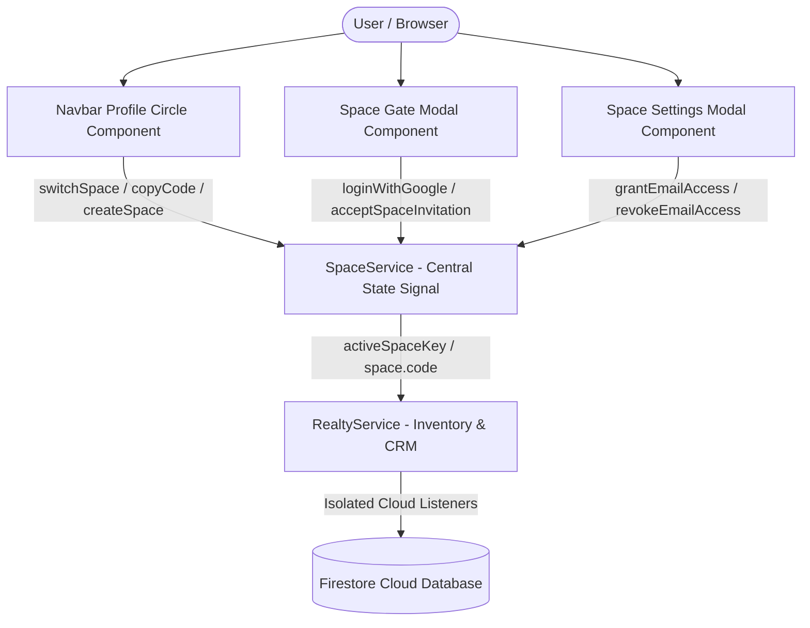
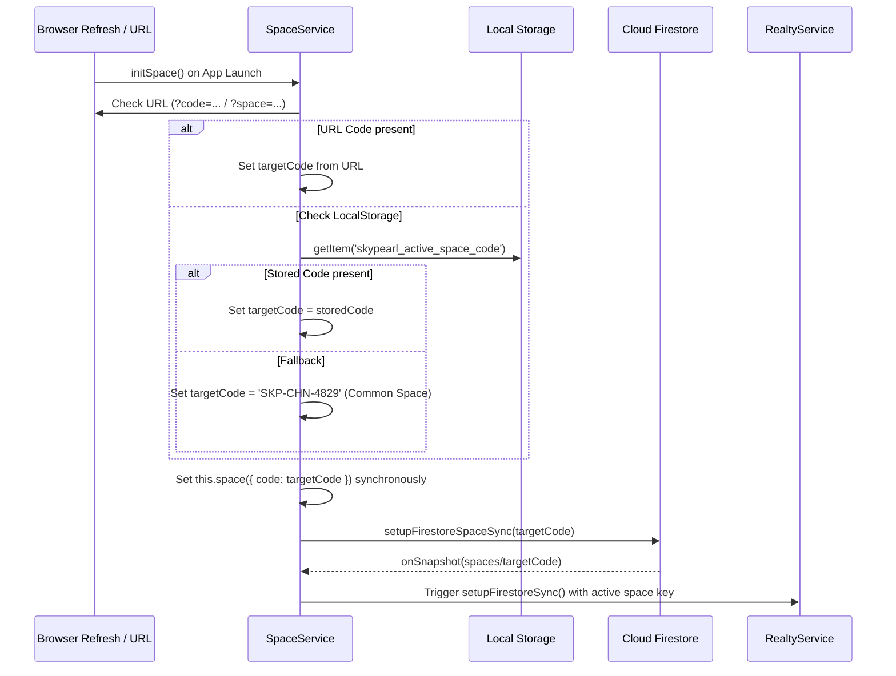

# SkyPearl Spaces — Frontend Architecture & Service Guide

This document explains how the **Spaces & Multi-Tenancy System** operates on the frontend in the SkyPearl Realty application. It details the state management with Angular Signals, component interactions, space switching, and user authorization flows.

---

## 1. High-Level Frontend Architecture

The frontend is built with **Angular (Standalone Components & Reactive Signals)**. All space multi-tenancy, member evaluation, and permissions are centralized in [`SpaceService`](file:///d:/Web%20Development/VASANTH/skypearl/src/app/services/space.service.ts).



---

## 2. Core Frontend Service: `SpaceService`

File: [`src/app/services/space.service.ts`](file:///d:/Web%20Development/VASANTH/skypearl/src/app/services/space.service.ts)

### A. State Signals (Angular Signals)

| Signal | Type | Description |
|---|---|---|
| `space` | `signal<AgencySpace>` | The currently loaded agency space (name, code, owner, members, allowedEmails). |
| `activeSpaceMode` | `signal<'agency' \| 'personal'>` | Toggle between team agency workspace and private solo agent mode. |
| `availableSpaces` | `signal<SpaceSummary[]>` | List of all spaces the user owns, has joined, or has been invited to. |
| `isUnlocked` | `signal<boolean>` | `true` when the user has verified access to the current space. |
| `showAccessModal` | `signal<boolean>` | Controls visibility of the Space Gate modal when authentication or authorization is required. |
| `showSpaceSettingsModal` | `signal<boolean>` | Controls visibility of the Team Management modal. |
| `activeUserInvite` | `signal<DirectInvite \| null>` | Real-time cross-device invite received via `user_invites/{email}`. |
| `isSpaceLoading` | `signal<boolean>` | Indicator while snapshot is loading from Firestore. |

### B. Computed Signals (Reactive RBAC)

- **`isOwner`**:
  Determines if the logged-in user is the space creator or owner:
  ```typescript
  (ownerEmail && userEmail === ownerEmail) ||
  (ownerUid && user.uid === ownerUid) ||
  members.some(m => m.id === user.uid && m.role === 'owner')
  ```
- **`verifiedMember`**:
  Retrieves the current user's profile inside the active space's `members` directory.
- **`currentRole`**:
  Returns `'owner'`, `'admin'`, or `'agent'`.
- **`authorizedPendingEmails`**:
  Filters `allowedEmails` for accounts that have been authorized by the owner but have not yet logged in:
  ```typescript
  (currentSpace.allowedEmails || []).filter(e => !activeMembersEmails.has(e))
  ```
- **`pendingInvitation`**:
  Detects if the user has an active pending invitation to join the current or another space.

---

## 3. Initialization & Persistence Pipeline

To prevent space mismatch and ensure reliable persistence across page refreshes, `SpaceService` executes a deterministic initialization pipeline:



> [!IMPORTANT]
> **No Spontaneous Space Regeneration**:
> Previously, reloading without an invite or prior membership caused `createNewSpace()` to generate a random code and overwrite the user's active workspace. This has been eliminated. The app keeps users attached to their existing space or the Common Agency Space (`SKP-CHN-4829`).

---

## 4. Key UI Components & Interactions

### A. Profile Circle & In-Profile Workspace Switcher
File: [`src/app/components/navbar/navbar.ts`](file:///d:/Web%20Development/VASANTH/skypearl/src/app/components/navbar/navbar.ts)

Located in the top-right header, clicking the profile avatar opens the dropdown menu:

1. **Current Active Space Card**:
   - Displays Space Name & monospace Space Code with a 1-click **Copy Code** button.
   - Shows badge: `AGENCY TEAM` or `SOLO PRIVATE`.
2. **Mode Toggle**:
   - **Common Space**: Swaps into the collaborative agency workspace.
   - **Personal Mode**: Isolates listings to `personal-{uid}` for private leads.
3. **Available Spaces List**:
   - Lists all spaces from `availableSpaces()`.
   - Highlights the active space with an `Active` pill; inactive spaces show a `Switch →` button.
4. **Quick Code Switcher**:
   - Text input where agents or brokers can paste any space code (e.g. `SKP-CHN-4829`) and switch instantly.
5. **Inline "+ Create New Agency Space"**:
   - Expands an input field to create a new branch workspace with custom naming.
6. **Team & Authorized Directory**:
   - Displays active members with Google photo, name, and role.
   - Displays pre-authorized invitations with amber badge `✓ AUTHORIZED • PENDING SIGN-IN` and quick **Copy Link** button.

---

### B. Space Gate Modal
File: [`src/app/components/space-gate-modal/space-gate-modal.ts`](file:///d:/Web%20Development/VASANTH/skypearl/src/app/components/space-gate-modal/space-gate-modal.ts)

Activated when an unauthenticated or unauthorized user visits a private space.

- **State 1: Unauthenticated**:
  - Displays Google OAuth sign-in button.
  - Option to enter "Solo agent mode" (Personal mode).
- **State 2: Pre-Authorized Invite Detected**:
  - Displays **"PRE-AUTHORIZED BY OWNER: Zero Approval Needed • Instant Access"** spotlight banner.
  - Shows space name, space code, and the inviting owner's name.
  - Primary button: **Accept Invitation & Enter Space**.
- **State 3: Unlisted User on Private Space**:
  - Provides a **Request Access from Owner** button.
  - Option to return to the Common Agency Space (`SKP-CHN-4829`).

---

### C. Space Settings Modal
File: [`src/app/components/space-settings-modal/space-settings-modal.ts`](file:///d:/Web%20Development/VASANTH/skypearl/src/app/components/space-settings-modal/space-settings-modal.ts)

Dedicated management panel for workspace owners and administrators:

- **Grant Access by Email**:
  - Owner enters `agent@gmail.com`.
  - Immediately appends to `space.allowedEmails` and registers in `user_invites` in Firestore.
  - Appears instantly in the directory as `AUTHORIZED • Pending First Sign-in`.
- **Pending Join Requests**:
  - Approve as Agent, Approve as Admin, or Decline.
- **Active Directory**:
  - Shows registered members, roles, joined date, and last active time.
  - Owner can change roles (`admin` / `agent`) or revoke access.
- **Invite Actions**:
  - Direct WhatsApp invitation generator with auto-formatted message and join link.
  - 1-click **Copy Join Link** button.

---

## 5. Reactive CRM & Inventory Synchronization

File: [`src/app/services/realty.service.ts`](file:///d:/Web%20Development/VASANTH/skypearl/src/app/services/realty.service.ts)

`RealtyService` reactively tracks the space signals:

```typescript
effect(() => {
  const googleUser = this.authService.currentUser();
  const isUnlocked = this.spaceService.isUnlocked();
  const spaceCode = this.spaceService.space().code;
  const spaceMode = this.spaceService.activeSpaceMode();

  untracked(() => {
    // Automatically re-establishes cloud listeners when space or mode changes
    this.setupFirestoreSync();
  });
});
```

Whenever the user switches spaces:
1. `getActiveSpaceKey()` resolves the new target key: `spaceService.space().code` or `personal-{uid}`.
2. In-memory arrays (`properties`, `leads`, `siteVisits`) are cleared to prevent cross-workspace data bleed.
3. New Firestore listeners are attached to `/spaces/{spaceCode}/properties`, `/spaces/{spaceCode}/leads`, etc.
4. Real-time data populates instantly without requiring a full browser reload.

---

## 6. Frontend User Workflows

### Scenario 1: Owner Pre-Authorizes a Team Member
1. Owner opens **Profile Circle** -> clicks **Manage Team** (or clicks **+ Add Member** in the dropdown).
2. Owner types `teammate@gmail.com` and clicks **+ Grant Access**.
3. Frontend updates:
   - `allowedEmails` updates locally in the signal.
   - `authorizedPendingEmails()` immediately shows `teammate@gmail.com` in both the Profile dropdown and Team settings directory.
   - Firestore writes to `/spaces/{code}` and `/user_invites/teammate@gmail.com`.
4. Owner refreshes the page:
   - Space code remains identical.
   - `teammate@gmail.com` remains visible in the authorized list.

### Scenario 2: Authorized Agent Enters the Space
1. Agent opens `https://skypearl.in/` (or clicks an invite link with `?code=SKP-CHN-4829`).
2. Agent signs in with their Google Account (`teammate@gmail.com`).
3. `SpaceService` listens to `/user_invites/teammate@gmail.com` -> finds the invite.
4. Agent clicks **Accept Invitation & Enter Space**.
5. Frontend registers agent in `space.members` with role `'agent'` and status `'active'`.
6. On the Owner's screen, the real-time `onSnapshot` automatically converts the member from "Pending" to "Active" with their Google display name and photo.
7. Both Owner and Agent are now synchronized in the same shared workspace code.
